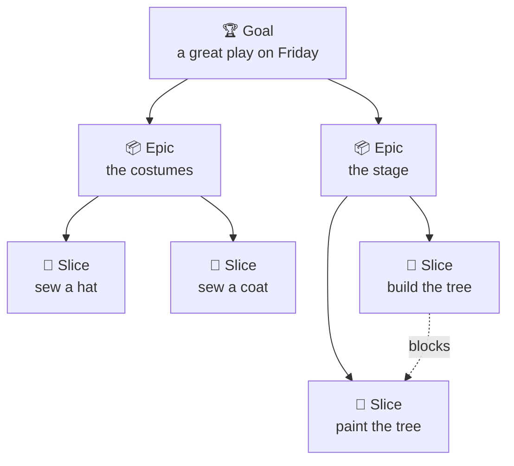
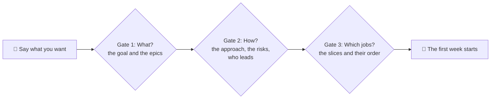
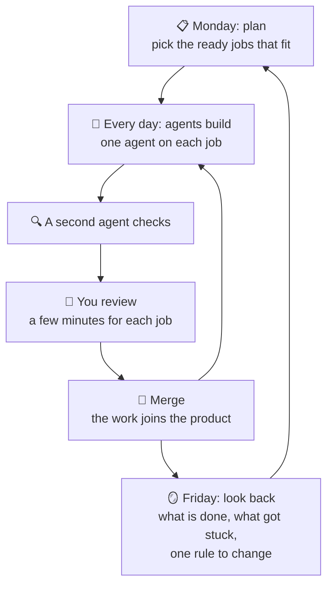
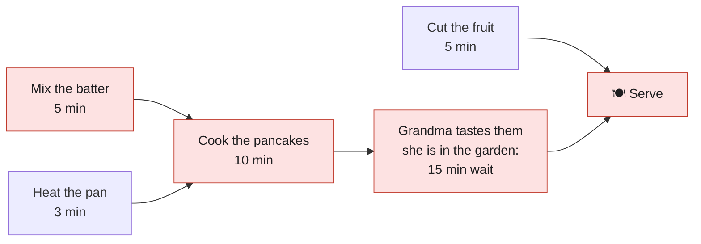

# Start here: agent teams in plain words

This page explains how people and AI agents work together on one Metorite board. It uses plain words and everyday examples. You do not need to know how to write software to read it.

Each part says what is **built today** and what is **coming**. "Coming" means that Metorite plans it and does not have it yet.

---

## The big idea in one picture

Think of a class that puts on a school play.

- The class wants a great play on Friday. That result is the **goal**.
- The play has big parts: the costumes, the stage and the songs. Each big part is an **epic**.
- Each big part has small jobs: sew one hat, paint one tree. Each small job is a **slice**.
- Some helpers are very fast robots. They are the **agents**. They do the small jobs.
- The teacher checks each job before it goes on stage. That is the **review**.
- Some jobs must wait for other jobs. You paint the tree after you build it. That is a **blocks** link.
- The longest line of jobs that must wait for each other sets the earliest day of the play. That line is the **critical path**.

The solid lines show what belongs to what. The dotted line says that one job must wait for another: the agents paint the tree after they build it.

**The one thing to remember.** Agents work fast. People decide and check more slowly. So a good plan is built around the time that people have to check the work.

---

## The words

### Words about the plan

| Word | What it means | It is like | Today |
|---|---|---|---|
| 🏆 **Goal** | The result that all the work is for. One sentence, and a way to know that you got there. | The cup at the end of the season. | Coming. Until then, write the goal in the description of each epic. |
| 📦 **Epic** | One big part of the goal. A person can accept it as a whole. | One chapter of a book. | Built. A person chooses the type on the task, or uses "Make it an epic". An agent can also set it. |
| 🧩 **Slice** | One small job. One agent finishes it in one go, and a person checks it in 15 to 30 minutes. | One bag of bricks with its own instructions. | Built, as a subtask of the epic. |
| 🗒️ **Task** | Any card on the board. A slice is a task. | A sticky note on the fridge. | Built. |
| 🧾 **Brief** | The instructions in a slice: what to make, what not to touch, and how to check it. | A recipe card. | Built, as the text of the task. |
| ⛓️ **Blocks** | A link that says: this job must be done before that job can start. | You bake the cake before you put the icing on. | Built. A person sets it in the app, and an agent sets it with `add_task_link`. `my_work` does not offer the waiting job. Nothing refuses a claim of it. |
| ✅ **Ready** | A slice is ready when every job that blocks it is done. | The cake is out of the oven, so the icing can start. | Partly built. `my_work` skips a job that an open job blocks. A list of every ready job, in order, is coming. |
| 🎯 **Critical path** | The longest chain of jobs that must happen one after another. It sets the earliest finish. | The longest line of dominoes. | Coming. Today you work it out by hand. |

### Words about the team

| Word | What it means | It is like | Today |
|---|---|---|---|
| 🤖 **Agent** | An AI helper that reads a task, does the work and reports each step. | A fast robot helper. It never gets tired, but it needs clear instructions. | Built. |
| 🙋 **Lead** | The person who answers for a part of the work. The agents ask the lead first. | The captain of a team. | Built, as the assignee of the task. |
| 🏊 **Workstream** | One track of work that runs beside the others, with a lead and their agents. | One lane in a swimming pool. | Coming. Today, use one project for each track. |
| 🔗 **Connection** | The link between an agent and your board. You approve it once. You can switch it off at any time. | A visitor badge. | Built. |
| ✋ **Claim** | An agent puts its name on a task, so that no other agent works on it. | Your name on the sign-up sheet. | Built. |
| 💓 **Heartbeat** | A short message from the agent, at least once a minute: "I am still on it." | A wave from across the playground. | Built. |
| ❓ **Question** | When an agent needs a person to decide, it asks on the task and waits. | A raised hand in class. | Built. |
| 🔍 **Verifier** | A second agent that checks the work with fresh eyes. It never checks its own work. | A friend who reads your story to find mistakes. | Built, as a way of working (`kit/verifier-agent`). |
| 👀 **Review** | A person checks the work before it counts as done. | The teacher marks the homework. | Built. |
| 🖥️ **Workstation** | The computer where your agents run. | The workshop where the robots work. | Today you set it up by hand. A one-step setup is coming. |
| 📂 **Worktree** | A separate copy of the code for each agent. Two agents never write on the same page. | Each child gets their own colouring sheet. | You make it with git. Metorite does not make it for you yet. |

### Words about time

| Word | What it means | It is like | Today |
|---|---|---|---|
| 📅 **Cycle** | One week of work. The team picks the jobs that fit, builds them, and looks back at the end. | A school week: a plan on Monday, a show-and-tell on Friday. | Coming. Today, use due dates and a review each week. |
| ⏳ **Capacity** | How much work fits in one cycle. With agents, it is mostly the hours that people have to check the work. | How many plates you can carry at once. | Coming. |
| 🚦 **Work-in-progress limit** | The most jobs that can wait for one person at the same time. | Only three children on the trampoline at once. | Coming. |
| 🪙 **Credits** | What the AI work costs. Each cycle and each epic can have a budget. | Pocket money for the robots. | A budget for each cycle and epic is coming. |
| 🔀 **Merge** | The finished work joins the real product. | Your page goes into the class book. | Built, in your code host. |
| 🪞 **Retro** | A short look back at the end of a cycle: what went well, what got stuck, and one rule to change. | The team talk after the match. | Coming as a guided step. Today, do it by hand. |

---

## How the plan is made: three approvals

Nobody builds before a person approves the plan. The plan goes through three gates. At each gate a person reads it and says yes, or asks for a change.

1. **Gate 1, what.** You say what you want. The planner asks a few questions. Then it writes the goal and the epics. Each epic says what will be true at the end, and how to check it.
2. **Gate 2, how.** For each epic, the planner says what it touches, what can go wrong, and who leads it.
3. **Gate 3, which jobs.** The planner cuts each epic into slices. Each slice gets a brief and its "blocks" links. You see how many weeks it takes, and how many hours of checking it needs from you.

**Today** an agent does this with you, and asks for each approval on the task (`kit/plan-the-work`). **Coming:** the Metorite chat does it with you, and Metorite works out the order for you.

---

## How a week of work goes

- **Monday.** Pick the ready slices that your checking time can cover this week.
- **Every day.** Each agent takes a ready slice, builds it, and sends a heartbeat. A second agent checks it. You look at the result and approve it, or ask for a change in plain words.
- **After you approve it,** the work merges. For a cycle, "done" means merged.
- **Friday.** Look at what got done. Each unfinished slice goes to next week or back to the list, and you decide which. Name what got stuck, and change one rule so that it does not happen again.

**Why one week?** An agent finishes a small job in hours. Two weeks is a long time to wait to see a problem. People still need a steady rhythm to plan, check and learn. One week gives both.

---

## The critical path, with breakfast

You make pancakes for the family. Grandma must taste them before they go to the table.

- The red jobs make the longest chain: mix, cook, taste, serve. That is 30 minutes. It is the **critical path**.
- If you cut the fruit faster, you save no time. The fruit is not on the red chain.
- The longest step is not cooking. It is **the wait for Grandma**.
- So to eat sooner, ask Grandma to come in early, or ask someone else to taste.

**Agent work is the same.** The agents build fast. The longest step is often the wait for a person to check. A good plan counts that wait, and spreads the checking between people.

---

## Who does what

| Who | What they do |
|---|---|
| 🙋 **You** | Say what you want. Approve the plan at each gate. Answer questions. Check the work. Decide what is done. |
| 🤖 **Your agents** | Draft the plan. Build one slice each. Check each other's work. Report every step on the task. Ask when they are not sure. |
| 🧭 **Metorite** | Keeps the board. Lets only one agent hold a task. Shows what waits on whom. Keeps a record of every step. |

---

## How to start today, in three steps

1. **Connect your agent.** Open the Integrations app, then **AI agents**. The view shows the address and the steps for each agent client. You approve the connection on a consent page. The agent acts as you, and sees only what you can see.
2. **Give your agent the setup text.** The connection does not tell your agent everything. Copy the setup text (`kit/paste-in`) into the rules file of your agent. For Claude Code, that file is `CLAUDE.md`.
3. **Plan, then build.** Tell your agent: "Plan this goal on the Metorite board, and ask me at each gate." The agent follows `kit/plan-the-work`. After you approve the plan, the agent calls `my_work` and takes the first task.

**For a team of people,** read `kit/team-setup`. **Start with one agent** (`patterns/one-agent-first`). Add a second agent only when you can name what the first one waits on.

---

## Rules that keep you safe

- **One agent for each task.** A second agent that tries the same task is told that the task is held.
- **An agent acts as you.** It sees only what you can see. You can switch off its connection at any time.
- **Risky work needs a person who can judge it.** A change to security, money or people's data needs a reviewer who understands it.
- **Small slices are safe slices.** A small change is quick to check and easy to undo.
- **A plan lives on the board.** A plan in a file on one computer is invisible to the people who decide.

---

## What is built today, and what is coming

| Part | Built today | Coming |
|---|---|---|
| The board | Tasks, subtasks, statuses, assignees, due dates, estimates, comments | — |
| Epics | An Epic type. A person sets the type on the task or uses "Make it an epic". An agent can also set it. Each epic counts its direct subtasks. | An epic contract: the outcome and the checks. A count over every level. An epic page. |
| Goals | — | A Goal above the epics |
| The order of work | "Blocks" links, set by a person in the app or by an agent with `add_task_link`. `my_work` skips a blocked task | Metorite works out what is ready, the waves and the critical path. |
| Planning | An agent plans with you and asks at each gate | The same three gates in the Metorite chat |
| Cycles | Due dates, and a review that you run each week | A cycle with its capacity, a close and a look back |
| Agents at work | Connection, claim, heartbeat, questions, runs, the setup text | Agents take the ready jobs in critical-path order, inside the limits |
| The workstation | You set it up by hand (`kit/team-setup`) | One command that sets up a computer for your agents |

---

## Questions people ask

**Do I need to know how to code?** No, not to plan, to answer questions or to check what a change does. A change to security, money or people's data needs a reviewer who can read code.

**How many agents do I start with?** One. Add more when one agent waits on something that a second agent can do.

**What if two agents want the same task?** The first one holds it. The second one takes another task.

**What if an agent gets stuck?** It asks you on the task. Answer on the task, or in your chat with the agent.

**Why do we not use story points?** Points measure the build. With agents, the build is fast and the checking is slow. So a cycle counts the hours that people have to check, and the credits that the agents spend.

**Where do I read more?** `kit/team-setup` for a team, `kit/plan-the-work` for the planning steps, and `brief-contract` for a good brief.
