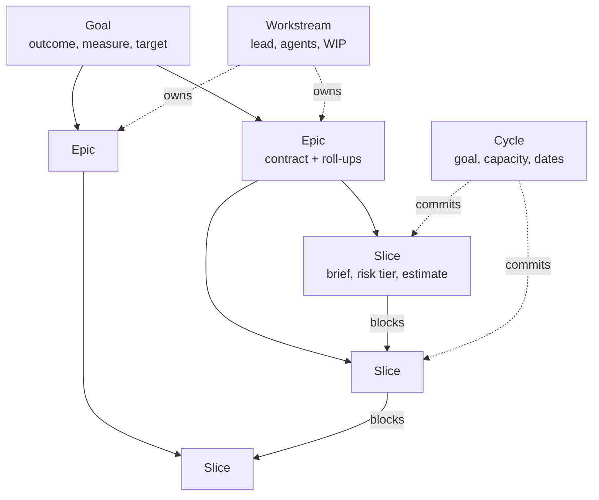
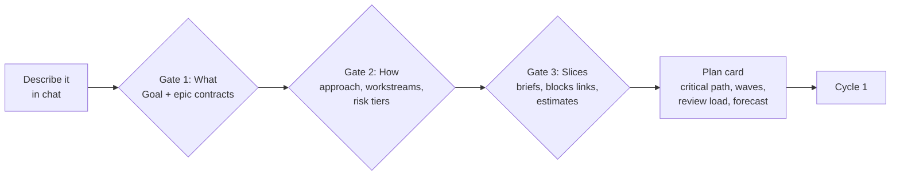
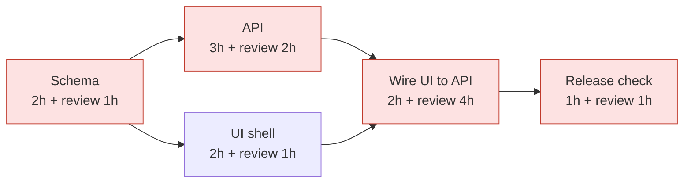
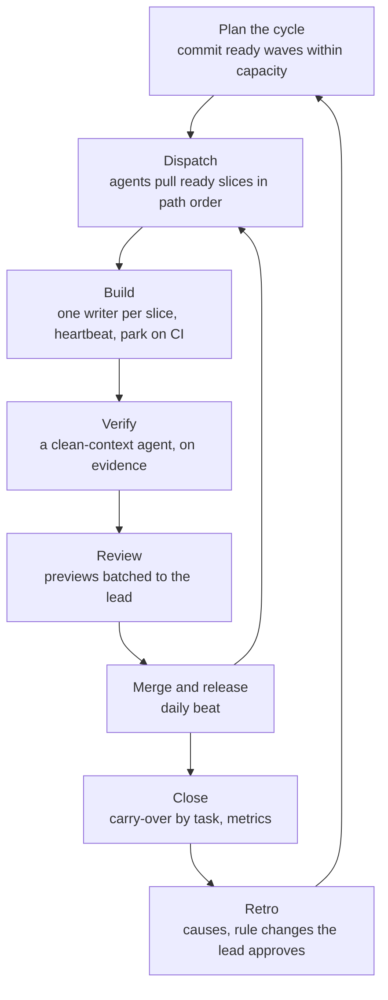
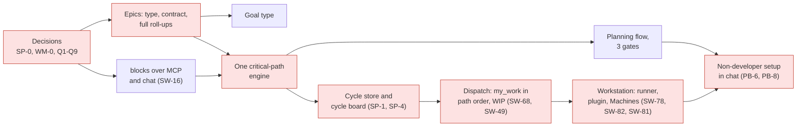

# Planning for agent swarms: goals, epics, cycles and the critical path

**Design proposal SP-A, Metorite task 2247, 2026-11-08.** This file is a proposal, not a spec. Nothing is built from it before the owner answers §11 and the owning specs take the rows (§10). Research prose follows the INFORMED tier of `docs/style_ste.md`.

**Owner ask, 2026-11-08:** "Let's keep cycles, sprints, whatever, so that we can organize our agents into these sprints of activities. We are going towards a singular shared goal, where we are parallelizing multiple work streams that make sense for a specific kind of output. Think about what Scrum looks like in the age of AI agents ... I think even the system for epics is not properly fleshed out ... how it can be done by somebody who is not very familiar with software development." The owner named the order: the plan first, then the critical path, then sprints and cycles, then the multi-agent workstation and its local harness.

**Decision recorded with this proposal (owner, 2026-11-08):** cycles and sprints are in scope, for agents as well as for people. It confirms the reversal of 2026-10-29 (WM-0, task 979). SP-0 (task 959) records it in the spec.

**Accepted by the owner, 2026-11-08: all nine answers of §11.** Decision D195 in `work_plan.md` §3. The rows live in the specs named in §10.

---

## 1. The answer first

- **Agent-era Scrum keeps three things from Scrum.** One goal for each time box. A plan that a person approves before the work starts. A review of evidence at the end.
- **It drops three things.** Story points, the default of two weeks, and the daily meeting.
- **The scarce resource moves.** Agents build a slice in hours. People decide and review slowly. So Metorite sizes a cycle by **the review and decision hours of named people, and by credits**, not by build hours.
- **Metorite has the parts for one agent on one task.** The claim, the lease, the questions, the runs and the evidence are live. It does not have the layer above: a goal, a real epic, dependencies that a machine reads, a cycle, a ready queue in critical-path order, and a guided setup. All of these are specced or ticketed. None is built.
- **The proposal has five parts.**
  1. One plan model of five records: Goal, Epic, Slice, Workstream and Cycle (§4).
  2. One planning flow in chat with three approval gates (§5).
  3. One critical-path engine, which code computes and every surface reads (§6).
  4. One cycle loop for a swarm (§7).
  5. A setup of three steps for a person who is not a developer (§8 and §9).
- **Build order.** Epics, dependencies and the critical path come first, because cycles and dispatch read them (§10).
- **Nine decisions wait on the owner** (§11). Each has a recommendation.

---

## 2. What the research says

Three surveys fed this proposal. The full notes are on task 2247, and the sources are in §12.

**Outside practice (2025 to 2026).** The evidence is thin. Most writing on "sprints for agents" is practitioner blogs. No large vendor publishes a time box for agents. The patterns that repeat are these:

1. **The goal is the unit, not the sprint.** One visible outcome, and a budget (Shape Up calls it the appetite).
2. **Plan in three gated layers:** what and why, then how, then tasks. A person approves each layer. Kiro (requirements, design, tasks), GitHub Spec Kit, the plan modes of Claude Code, Lovable and Replit.
3. **The task brief is the planning.** Objective, output, tools, boundaries and checks (Anthropic's multi-agent research system).
4. **Ready means that every dependency is done.** The tools recompute the ready set after each completion, and they run it in waves (Kiro: "tasks within a wave execute concurrently").
5. **Work in parallel across slices, and keep one writer inside a slice.** Cognition (2026): parallel writers on one change fail.
6. **Capacity is human review.** Agents can produce more than people can review. WIP limits make a pull system (the Kanban Guide).
7. **The critical path runs through the human gates.** A chain that waits on a review waits on a person.
8. **A clean-context agent verifies, on evidence.** The verifier sees the diff, not the builder's story.
9. **The standup becomes a status page.** Merged, waiting on you, blocked, failed.
10. **A retro fixes the structure, not the prompt.** A repeated mistake becomes a rule.
11. **Progress is uncertainty, not a task count.** A hill chart shows "still unknown" against "solved".
12. **Measure outcomes.** METR (2025) measured developers 19 % slower while they believed they were 20 % faster. A self-reported speed-up is not evidence.

**Metorite's Projects model today.** An epic is a task whose type has `is_epic`, with one rule (an Epic cannot have a parent). It rolls up only a done and total count of its direct children. It has no epic view, no outcome or acceptance field, and nothing above it: no goal, milestone, initiative or roadmap. Links are `blocks`, `relates_to` and `duplicates`. Only `blocks` is directed. No code computes a ready set or a critical path. That maths is planned three times: SW-90 (task 1936), PJP-6 (task 1483) and WM-3 (task 982).

**Metorite's agent orchestration today.** The loop for one agent is live: 32 MCP tools, `my_work`, claims with a two-hour lease, runs, questions, "Ask an agent", Needs attention and Resume. Guidance layers, the protocol block, resources and the session key are merged and dark. Everything that makes a managed swarm is planned only: lanes (SW-67), the capacity queue (SW-68), the brief (SW-70), the delivery pipeline (SW-71), the run queue (SW-89), the ready set (SW-90), digests (SW-91), the policy store (SW-94), budgets (SW-95), the kill switch (SW-96), the runner (SW-78), machines (SW-77, SW-81), the plugin (SW-82) and a worktree for each claim (SW-85). A non-developer can set up none of it in the product today.

---

## 3. Scrum in the age of agents

Each row names a Scrum practice, what it becomes when agents do most of the build, and the Metorite part that serves it.

| Scrum | With agents | Metorite part |
|---|---|---|
| Sprint goal | **Cycle goal**, tied to one Goal record | Cycle (SP-1), Goal (§4) |
| Story points and velocity | **Appetite**: credits and review hours. Throughput by count | Cycle capacity (§7), RA reports |
| Two weeks | **One week**, with the daily release as the beat inside it (a design call, not a sourced fact) | Cycle length (Q1) |
| Sprint planning | **Three gated layers**: what, how, slices | Planning flow (§5) |
| Definition of Ready | **The brief passes its contract, and every blocker is done** | Brief (SW-70), ready set (§6) |
| Ordered backlog | **The ready set, in critical-path order, then by value** | Critical-path engine (§6), `my_work` order |
| Team capacity | **Review slots for each person**, and WIP limits | Review cap (SW-49), capacity queue (SW-68) |
| Pair or mob | **One writer for each slice**, many slices at once | Claim with 409, path claims (SW-69) |
| Daily standup | **A morning digest**: merged, waits on you, blocked, failed, the path | Digests (SW-91), My Day |
| Sprint review | **Evidence on each task**, and the previews batched to the lead | Evidence panel (SW-87), approve many (SW-92) |
| Burndown | **Hill chart for each epic, and the slip of the critical path** | Epic page (§4.3) |
| Overrun | **Circuit breaker**: a slice that passes its appetite stops and goes back to shaping | Budgets (SW-95) |
| Hardening | **Cooldown is the harden pass** of each feature | Two-speed rule (`engineering_practice.md` §7a) |
| Retrospective | **Name the cause, then change a rule**, approved by the lead | Retro prompt (PB-2), causes (SW-99), lessons (SW-98) |

---

## 4. The plan model, and the fix for epics

### 4.1 Five records

1. **Goal.** The outcome that the work is for. Fields: the outcome in one sentence, how we know it is met, a target date or cycle, a lead, and a health. It is a task type in the one task store (D52), so it needs no second store. It sits at the top of a space or a project, and it is the parent of its epics. It answers WM-5 (task 984).
2. **Epic.** One output that the goal needs, which a reviewer can accept as a whole. It carries a **contract** (§4.2) and **roll-ups** (§4.3). Its parent may be a Goal, and nothing else.
3. **Slice.** One unit that one agent finishes in one run, and that a person can review in 15 to 30 minutes. It carries the brief (SW-70), a risk tier, an agent estimate, a review estimate, its `blocks` links, an assignee (the person who answers for it) and a delegate (the agent, SW-29a). A slice has no slices. The steps inside a slice are the plan of its run (SW-32).
4. **Workstream.** A parallel track towards the goal, usually one app project or one area. It has a lead, an agent setup (model, machine, how many at once) and a WIP limit. It is a lane record (SW-67) over the app owner map (SW-44). HathiLabs' lanes L1 to L8 are workstreams.
5. **Cycle.** A time box over a node (a space or a project), with a cycle goal that names a Goal, the slices it commits (a join table with `UNIQUE (task_id)`), a capacity snapshot, a start and a close, and a logged carry-over for each task. It is the SP-1 store (task 960).

### 4.2 The epic contract

| Field | What it holds | Who writes it |
|---|---|---|
| Outcome | One sentence: what is true when the epic is done | The lead, drafted by Mira |
| Acceptance | 3 to 7 checks that a reviewer can tick | The lead, drafted by Mira |
| Out of scope | What this epic does not do | The lead |
| Risk tier | LOW, STANDARD or HIGH. It sets the review depth | Proposed by code from the paths, the lead confirms |
| Appetite | Credits and review hours that the epic may spend | The lead |
| Workstream | The track that owns it | The lead |
| Spec link | A Knowledge page or a repository file | Anyone |

### 4.3 Roll-ups and the epic page

An epic computes these from all of its descendants, not only its direct children:

- **Progress:** slices done and total, and the estimate done and total.
- **Forecast finish:** from the critical-path engine (§6), with its buffer.
- **Health:** on track, at risk or off track, from the forecast against the target.
- **Hill position:** shaping, building, verifying or done, from the stages of its slices.
- **Spend:** credits used and review hours used, against the appetite.
- **Waits:** the open questions and previews, and on whom they wait.

The **epic page** shows the contract, the slice tree, the dependency graph with the critical path drawn, the runs and agents at work, the waits, and the evidence for each acceptance check. The **roadmap** shows goals and epics on a timeline, by cycle.

### 4.4 Why epics feel thin, and the fix for each cause

| Cause (survey of 2026-11-08) | Fix |
|---|---|
| Nothing in the app sets a task type, so few epics exist as data (`shownFields.ts:78`) | A type control on the task, "Make it an epic", and the chat and MCP can set it |
| A tag "Epic" and the Epic type both exist. Epic 19 has the tag and no type | One-off move: a task tagged Epic becomes the Epic type, and the tag stays as a plain tag |
| The roll-up counts only direct children | Roll-ups over all descendants (§4.3) |
| No epic page | The epic page (§4.3) |
| No outcome or acceptance field | The epic contract (§4.2) |
| Nothing above the epic | The Goal type (§4.1). An Epic may have a Goal parent |
| Plans link slices with `relates_to`, so nothing can compute "ready" | A tool to set `blocks` over MCP and chat (SW-16, task 347), and the planning flow writes `blocks` |
| The critical-path maths is planned three times | One engine with one owner (§6, Q8) |

---

## 5. The planning flow: plan first, with three gates

The flow runs in chat, so a non-developer can use it. An outside agent runs the same flow through the MCP prompt `plan_slices` (PB-2). Each gate ends with one approval card. The planning spec (`project_planning.md`, WS-PJP) already holds a ten-step flow for one project. This flow extends it with the goal, the workstreams and the cycle. It does not add a second flow.

1. **Gate 1, what.** The member says what they want. Mira asks at most five questions, then drafts the Goal and two to six epic contracts. The card shows the outcome and the acceptance checks of each epic. The member approves or edits.
2. **Gate 2, how.** For each epic, Mira (or a planning agent) writes a short approach: which apps or areas it touches, the main risks, the risk tier, and the workstream that owns it. The lead approves.
3. **Gate 3, slices.** Mira breaks each epic into slices with briefs, `blocks` links and estimates. Code computes the ready set, the waves, the critical path and the forecast (§6). The card says, for example: "3 workstreams, 24 slices, 5 waves. The critical path is 9 slices. Forecast: 2 cycles. Your review load: about 4 hours a week." The lead approves.
4. **The cycle plan.** Cycle 1 takes the first waves that fit the capacity (§7.2). The card names the cycle goal.

**A plan lives on the board, never only in a file.** A plan file in the repository is invisible to the board, to the critical path and to the people who decide. Outside tools that keep the plan in a file (Kiro, Spec Kit, Task Master) can import it through the MCP. The board stays the state (D118).

---

## 6. The critical path: one engine, computed by code

**Inputs.** The slices and their `blocks` links. A link between two epics expands to links between their slices. Each slice has a duration: the agent estimate, plus **the expected wait for its review**, from the measured answer time of its reviewer (SW-93). So a chain that waits on a busy person is long, as it is in real life.

**Outputs.**

- **The ready set:** open slices whose blockers are all done.
- **The waves:** wave 1 is ready now, wave 2 is ready when wave 1 is done, and so on.
- **The critical path:** the longest chain to the goal, with the slack of every other slice.
- **The forecast finish:** the path length plus a buffer (Critical Chain), shown as a 50 % and an 85 % date. The Monte Carlo forecast of RA-6 already gives these two dates by count.
- **The next slice:** the ready slice on the critical path with the least slack, then by value.

In this example the critical path is Schema, API, Wire, Release check. The longest single item on it is not a build: it is the four-hour wait for the review of "Wire UI to API". The fix is a second reviewer or an earlier preview, not a faster agent.

**Who reads it.** `my_work` orders the ready slices of the active cycle by it. The epic page and the cycle board draw it. The digest warns when it slips. A blocked slice on the path goes to the lead. The MCP gets one read tool, such as `get_plan`, for an outside planner.

**One engine, one owner.** SW-90 (task 1936), PJP-6 (task 1483) and WM-3 (task 982) plan the same maths. This proposal gives it to one module in the gateway, owned by `project_planning.md`. SW-90 and WM-3 read it. The model never computes a path, as `project_planning.md` already says: code computes and the model judges. It recomputes on each status or link change.

---

## 7. The cycle loop for a swarm

### 7.1 Length

- **One week by default** (Q1). An agent finishes a slice in hours, so two weeks leaves agents idle and hides slips. People still need a weekly rhythm to plan, review and learn.
- **The daily release is the beat inside the cycle.** At HathiLabs it is 21:30 UTC. Each organization sets its own.
- **An optional cooldown.** One or two days at the end, for the harden pass and for shaping the next cycle.

### 7.2 Capacity

- **Review hours of each person, a week.** Each person sets their own number. Metorite measures it against reality (SW-93).
- **Credits.** The cycle has a credit budget. Each epic has an appetite inside it.
- **WIP limits.** At most N previews wait on one person (SW-49), and at most N agents run in one workstream (SW-67).
- **The plan card warns, and never blocks.** "This cycle needs 9 review hours from Ravi. Ravi has 5." That follows the SP-3 default (a capacity bar that warns).

### 7.3 During the cycle

- **Dispatch is a pull.** An agent calls `my_work`, and gets the ready slices of the active cycle in critical-path order, inside the WIP limits (SW-68). A person can still assign by hand.
- **One writer for each slice.** The claim holds it (409 `task_held`). Path claims (SW-69) warn about two slices that touch the same files.
- **Waits are parked, not held.** A slice that waits on CI or a merge parks (SW-60, SW-66), so its agent can take the next slice.
- **Questions go to the lead of the workstream first** (SW-46).
- **The morning digest replaces the standup** (SW-91): merged, waits on you, blocked, failed, the slip of the critical path, and the spend.
- **The circuit breaker.** A slice that passes its appetite stops and goes back to shaping, with a question to the lead (SW-95).

### 7.4 Review, close and retro

- **Review is on evidence.** Each task shows its stages, checks, verdicts and captures (SW-87). LOW-tier previews go in one batch (SW-92).
- **"Done" for a cycle means merged** (Q5). The release is daily, so "live" follows within a day. The pipeline stage `live` (SW-72) stays the proof for a release.
- **The close asks for each unfinished slice:** the next cycle or the backlog. The move is logged. Nothing rolls over in silence.
- **The close shows:** cycle goal met or not, first-pass acceptance rate, review queue age, rework (fix rounds), credits for each merged slice, and the slip of the critical path. Never points, lines or PR counts.
- **The retro** runs the prompt `run_retro` (PB-2). It names each stall from the cause list (SW-99), and proposes rule changes. The lead approves each one before it spreads (SW-98, SW-42).

---

## 8. The workstation: where agents run

A workstation is a machine that runs agent sessions for one person or one team. Three paths exist, from least to most effort for the member.

| Path | What the member does | State |
|---|---|---|
| **A. Cloud agents** | Nothing to install. Metorite hands a ready slice to a cloud coding agent, and the result comes back as a pull request | Proposed only (WS-56). Needs a decision (Q7) |
| **B. One workstation** | Integrations, AI agents, "Set up a workstation". One command on a PC or a small server. Metorite connects it once and keeps it connected | Parts in flight: box token EA-19 (19a and 19b merged, 19c to 19e open PRs), runner SW-78, plugin SW-82, worktree per claim SW-85, Machines tab SW-81, doctor PB-7 |
| **C. By hand** | Install the agent client, run the connect command on each machine, paste the setup text, open one terminal and one worktree for each agent | Works today. `kit/team-setup.md` describes it (PR 1916) |

**What the one-command workstation installs (path B).**

1. **The connection.** A box token (EA-19), so the machine connects with one approval and stays connected.
2. **The runner** (SW-78). It starts a session for each ready slice up to the workstream's limit. It restarts a session that dies (SW-79). It reports the machine's health (SW-77).
3. **The plugin** (SW-82). The MCP config, the hooks that keep a session on its task, and a verifier and a reviewer agent.
4. **A worktree for each claim** (SW-85), removed at done or release.
5. **The doctor** (PB-7). It checks the setup against the playbook and says what to fix in plain words.

**How HathiLabs' hand-built harness maps to the product.**

| HathiLabs does by hand | The product part |
|---|---|
| `CLAUDE.md`, `AGENTS.md` and the paste-in text | Guidance layers (SW-31) and the plugin (SW-82) |
| `scripts/worktree.sh` | Worktree for each claim (SW-85) |
| Lanes L1 to L8 on the home server | Workstreams as lane records (SW-67), Machines (SW-81) |
| `/next-ticket`: audit, build, verify, review, merge | The delivery pipeline (SW-71) and the verifier role (SW-59) |
| Risk tiers set the review depth | `risk_tier` on the slice (SW-71), approve many for LOW (SW-92) |
| Owner previews on the task | Previews to the lead (SW-46), evidence panel (SW-87) |
| The weekly delivery review | Analytics (SW-93), the doctor (PB-7), the retro (§7.4) |
| Hooks that refuse unsafe acts (`plan-guard.mjs`) | The policy store (SW-94) and the kill switch (SW-96) |

---

## 9. A non-developer's path, end to end

**Priya runs a design studio of four people.** She wants a client portal. She has never used git.

1. **Plan (Day 0, 20 minutes).** In chat: "Plan a client portal for our studio." Mira asks four questions. Priya approves three cards: the goal and its epics, the approach, and the slices. The plan card says: two workstreams, 18 slices, 4 waves, forecast in 2 cycles, and about 3 hours of her review each week.
2. **Connect agents (Day 0, 10 minutes).** Integrations, AI agents, "Set up agents". She picks "On this computer" (path B) or "In the cloud" (path A). The doctor turns green.
3. **Run the cycle (each day, 15 minutes).** The morning digest on My Day says: "4 slices merged. 2 previews wait on you, about 15 minutes. The critical path is on track." She opens each preview, looks at the evidence, and approves or asks for a change in plain words.
4. **Close the cycle (Friday, 20 minutes).** The close card shows the goal met or not, and asks about each unfinished slice. The retro card proposes two rule changes. She approves one.

**Guardrails for a person who cannot judge code.**

- **A HIGH-tier slice needs a named reviewer who can judge it.** Metorite says so on the plan card. It never asks a non-developer to approve security, data access or money alone.
- **Every preview speaks plain words:** what changed, how to see it, what the checks found.
- **Every slice can be undone.** A merged slice reverts with one action.
- **Budgets and the kill switch stay in reach.** One action stops every agent of the person or the organization (SW-96).

---

## 10. Build order, and the critical path of this plan itself

| Phase | What it builds | Owning spec | Tasks |
|---|---|---|---|
| **0. Decisions** | The answers of §11, the sprint section, the work-style decision | `project_management_app.md`, WM spec | SP-0 (959), WM-0 (979), this task (2247) |
| **1. Plan model** | The type control and "Make it an epic", the move of the Epic tag, the epic contract, roll-ups over all descendants, the epic page, the Goal type, the `blocks` tool | `project_management_app.md`, `one_projects_app.md` | SP-2 (961), WM-5 (984), SW-16 (347), new tasks for the contract, roll-ups and page |
| **2. One engine** | Ready set, waves, critical path, forecast, `get_plan` | `project_planning.md` | PJP-6 (1483), SW-90 (1936), WM-3 (982) merged into one |
| **3. Planning flow** | The three gates in chat and over MCP | `project_planning.md`, `orchestration_playbook.md` | PJP flow, PB-2 (1948), PC-3 (972) |
| **4. Cycles** | The cycle store, the cycle board, capacity in review hours, close and carry-over, the digest | `project_management_app.md`, `agent_coordination.md` | SP-1 (960), SP-3 (962), SP-4 (963), SW-91 (1937) |
| **5. Dispatch** | `my_work` in path order inside the cycle, WIP and review caps, the brief, the pipeline, the circuit breaker | `agent_coordination.md` | SW-68 (1914), SW-49 (1882), SW-70 (1916), SW-71 (1917), SW-95 (1941) |
| **6. Workstation** | Box token, runner, plugin, worktree for each claim, Machines, doctor | `agent_coordination.md`, `external_agent_access.md` | EA-19 (1838 to 1842), SW-78 (1924), SW-82 (1927), SW-85 (1930), SW-81 (1926), PB-7 (1953) |
| **7. Guided setup and learning** | "Set up agents for my team" in chat, the retro, analytics, lessons | `orchestration_playbook.md`, `agent_coordination.md` | PB-6 (1952), PB-8 (1954), SW-93 (1939), SW-98 (1944), SW-99 (1945) |

**Dogfood.** HathiLabs runs its next Metorite work in cycles from phase 4, with lanes L1 to L8 as workstreams (Q9). Our own use is the first test of the non-developer path.

**Slices of this proposal that have no task yet.** The epic contract fields, the roll-ups over all descendants, the epic page, the type control with "Make it an epic", the move of the Epic tag, the `get_plan` read, and the merge of the three critical-path plans into one. SP-0 and the owning specs take them as rows, and each row gets its task in the same session.

---

## 11. Decisions for the owner

| # | Question | Recommended | Other choices |
|---|---|---|---|
| Q1 | The default length of a cycle | **One week**, with the daily release inside it and an optional cooldown | Two weeks; continuous flow with a weekly review |
| Q2 | The unit of capacity | **Review hours of named people, and credits** | Estimate hours; story points (P-31 refused them) |
| Q3 | Where a Goal lives | **A task type "Goal" in the one task store** | A separate goal record (a second store) |
| Q4 | How epics nest | **Goal, then Epic, then Slice. No epic inside an epic** | Nested epics |
| Q5 | When a slice is "done" for a cycle | **Merged** | Live in production |
| Q6 | How work reaches an agent | **Agents pull the ready slices of the active cycle by themselves, inside the WIP limits** | A person assigns each slice |
| Q7 | Which workstation path comes first for a non-developer | **One workstation with the runner (path B)**, because EA-19 and SW-78 are in flight | Cloud agents first (WS-56); both at once |
| Q8 | Who owns the critical-path maths | **`project_planning.md` (PJP-6)**. SW-90 and WM-3 read it | SW-90; WM-3 |
| Q9 | Dogfood | **HathiLabs runs Metorite work in cycles from phase 4** | Later |

---

## 12. Sources and limits

**Outside sources** (vendor or first party unless marked):

- Kiro specs: https://kiro.dev/docs/specs/
- Claude Code agent teams: https://code.claude.com/docs/en/agent-teams
- Cognition, multi-agents working (vendor): https://cognition.com/blog/multi-agents-working
- Anthropic, multi-agent research system: https://www.anthropic.com/engineering/multi-agent-research-system
- Shape Up: https://basecamp.com/shapeup
- The Kanban Guide: https://kanbanguides.org/english/
- Linear cycles: https://linear.app/docs/use-cycles
- METR uplift update, 2026: https://metr.org/blog/2026-02-24-uplift-update/
- DORA 2025 report announcement: https://cloud.google.com/blog/products/ai-machine-learning/announcing-the-2025-dora-report
- Agile ceremonies for coding agents (third party): https://codex.danielvaughan.com/2026/04/12/adapting-agile-ceremonies-ai-coding-agents/

**Not verified:** how Linear places agents in cycles; the dependency markers of Spec Kit; detail on Jules, Codex, Factory, Cursor and Amp (pages missing or off topic); v0 and Bolt; the seven DORA capabilities (from a Google summary); figures from Faros. No source sets a time box for agents. The one-week default is a design judgement.

**Internal sources:** `project-docs/specs/agent_coordination.md` (§3.8, §3.10, §3.11, §5.10, §5.11, Appendix B), `orchestration_playbook.md`, `project_planning.md`, `project_management_app.md` (§1, P-23, :3168), `external_agent_access.md`, `external_agent_dispatch.md`, `project-docs/research/linear_parity_2026-11.md`; the code in `gateway/routes/projects` (`core.py`, `tasks.py`, `filters.py`, `relations.py`, `analytics.py`, `analytics_capacity.py`) and `workbench/control_plane/src/app/projects`; and the comment "Research notes, 2026-10-29 (sprints)" on task 19.
